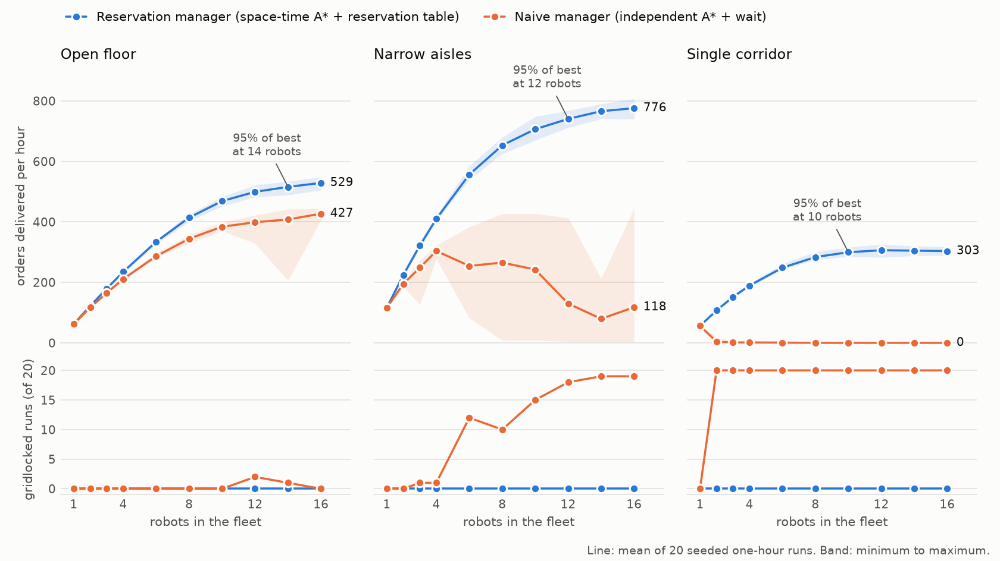
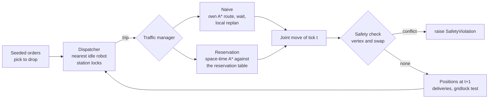

# amr-traffic-lab

**A seeded simulation study of Industry 4.0 smart-factory (Usine 4.0) intralogistics: how many autonomous mobile robots (AMRs) can a factory aisle take before it jams, with the no-collision invariant checked on every tick.**

[](https://github.com/guilhem0908/amr-traffic-lab/actions/workflows/ci.yml)

[Results](#results) - [Quickstart](#quickstart) - [How it works](#how-it-works) - [Limitations](#limitations)


<!-- BEGIN GENERATED: hero -->
*Same layout, same 12 robots, same seeded orders: seed 0, first 200 s, drawn by `scripts/reproduce.py`. The clip is not hand-picked: with 12 robots the naive manager gridlocks on this layout in 20 of 20 seeds. Here nothing moves on the left after t = 32 s.*
<!-- END GENERATED: hero -->

## Why this exists

During my research internship at AIST in Japan I wrote a single-robot A* planner on an occupancy grid ([nav_3dgs_pano](https://github.com/guilhem0908/nav_3dgs_pano)), and I prepared a ROS 2 interface for Kachaka, a mobile robot that docks under a shelf and carries it ([KachakaNavigation](https://github.com/guilhem0908/KachakaNavigation)). One robot on an empty map never meets the first question an Industry 4.0 smart factory (Usine 4.0) asks about a fleet: what happens when a dozen of them share one aisle? This repository is a personal side project in which I write a new grid A* (new code, not the AIST planner), then add time to it, then a reservation table, then Conflict-Based Search, and measure the outcome instead of only animating it. It is a personal project, independent of the final-year class project on Usine 4.0 at UPSSITECH (in progress). It was written with AI assistance, as the commit trailers say; the reasoning behind each choice is in [docs/design.md](docs/design.md).

## Results

<!-- BEGIN GENERATED: verdict -->
**The reservation manager never gridlocked (0 of 600 one-hour runs over the three layouts), and in the single corridor its throughput levelled off at 10 robots (299.7 orders/h, against 303.4 with 16).** The naive manager gridlocked in 180 of 180 corridor runs with two robots or more, but that is structural, not a surprise: a single lane with no passing place deadlocks any manager that lets robots enter from both ends and never backs up, and this one never does. The corridor row shows the size of that effect. The more informative comparison is on the open floor, where the naive manager rarely jams (3 of 200 runs) and the reservation manager still delivers 24% more orders per hour with 16 robots (528.9 against 427.2), and in the narrow aisles, one-cell lanes joined in a network, where the naive manager jams in 95 of 200 runs. A lock that lets one direction at a time into the corridor would be a fairer baseline for that row; this study does not measure one (see Limitations). Each cell below is 20 seeded runs of one simulated hour; the full grid of ten fleet sizes is in `results/lifelong_summary.csv`.
<!-- END GENERATED: verdict -->

<!-- BEGIN GENERATED: lifelong -->
| Layout | Robots | Reservation, orders/h (min-max) | Naive, orders/h (min-max) | Reservation gridlocks | Naive gridlocks | Reservation order time | Naive order time |
|:--|--:|--:|--:|--:|--:|--:|--:|
| Open floor | 2 | 122.2 (121-124) | 116.8 (114-119) | 0 / 20 (0%) | 0 / 20 (0%) | 58.4 s | 61.1 s |
| Open floor | 4 | 234.8 (231-237) | 211.0 (206-216) | 0 / 20 (0%) | 0 / 20 (0%) | 60.8 s | 67.6 s |
| Open floor | 8 | 414.1 (402-426) | 344.4 (329-357) | 0 / 20 (0%) | 0 / 20 (0%) | 66.8 s | 80.2 s |
| Open floor | 16 | 528.9 (505-549) | 427.2 (407-444) | 0 / 20 (0%) | 0 / 20 (0%) | 66.7 s | 81.9 s |
| Narrow aisles | 2 | 224.7 (218-232) | 195.2 (185-204) | 0 / 20 (0%) | 0 / 20 (0%) | 31.9 s | 36.6 s |
| Narrow aisles | 4 | 410.2 (402-420) | 303.9 (278-323) | 0 / 20 (0%) | 1 / 20 (5%) | 34.9 s | 46.8 s\* |
| Narrow aisles | 8 | 653.2 (625-680) | 265.4 (8-427) | 0 / 20 (0%) | 10 / 20 (50%) | 40.7 s | 66.5 s\* |
| Narrow aisles | 16 | 776.1 (740-807) | 117.7 (2-445) | 0 / 20 (0%) | 19 / 20 (95%) | 40.6 s | 71.1 s\* |
| Single corridor | 2 | 107.2 (104-109) | 3.9 (1-19) | 0 / 20 (0%) | 20 / 20 (100%) | 66.4 s | 63.8 s\* |
| Single corridor | 4 | 189.4 (185-196) | 1.2 (0-8) | 0 / 20 (0%) | 20 / 20 (100%) | 75.2 s | 59.2 s\* |
| Single corridor | 8 | 283.7 (275-301) | 0.0 (0-0) | 0 / 20 (0%) | 20 / 20 (100%) | 95.6 s | - |
| Single corridor | 16 | 303.4 (289-318) | 0.0 (0-0) | 0 / 20 (0%) | 20 / 20 (100%) | 101.6 s | - |

\* Order time is the mean over the orders delivered. In a group with gridlocked runs those are the orders delivered before the jam, so a jammed fleet can look fast: in the single corridor with 4 robots, the naive order time is 59.2 s against 75.2 s for reservation, while the naive fleet delivers 1.2 orders/h against 189.4.
<!-- END GENERATED: lifelong -->



**When do more robots stop helping?** Only the single corridor shows a real plateau, and there the aisle is the limit: the share of trip time spent waiting for the lane is the highest of the three layouts. On the other two the curve is still rising at 16 robots, the largest fleet the 16 chargers can park, and what flattens it is the 8 + 8 stations rather than traffic.

<!-- BEGIN GENERATED: saturation -->
| Layout | Reservation, best orders/h | 95% of best reached with | Trip time spent waiting at 16 robots | Naive, best orders/h | Smallest naive fleet with a gridlock |
|:--|--:|--:|--:|--:|--:|
| Open floor | 528.9 (16 robots) | 14 robots (515.7) | 0.3% | 427.2 (16 robots) | 12 robots |
| Narrow aisles | 776.1 (16 robots) | 12 robots (740.5) | 10.5% | 303.9 (4 robots) | 3 robots |
| Single corridor | 306.2 (12 robots) | 10 robots (299.7) | 27.7% | 56.0 (1 robot) | 2 robots |
<!-- END GENERATED: saturation -->

**Is prioritised planning far from optimal?** On one-shot instances, Conflict-Based Search (CBS) returns the optimal sum of path costs but runs out of its node budget as soon as many agents share single-lane aisles. Prioritised planning answers in milliseconds, fails less often there, and its extra path cost on the instances both solve is in the fifth column.

<!-- BEGIN GENERATED: oneshot -->
| Layout | Agents | CBS solved | Prioritised solved | Extra cost of prioritised | CBS median time | Prioritised median time |
|:--|--:|--:|--:|--:|--:|--:|
| Open floor | 4 | 25 / 25 (100%) | 25 / 25 (100%) | +0.4% on 25 instances | 0.71 ms | 0.38 ms |
| Open floor | 8 | 24 / 25 (96%) | 25 / 25 (100%) | +2.6% on 24 instances | 3.33 ms | 0.81 ms |
| Open floor | 12 | 22 / 25 (88%) | 25 / 25 (100%) | +5.2% on 22 instances | 19.4 ms | 1.52 ms |
| Narrow aisles | 4 | 21 / 25 (84%) | 25 / 25 (100%) | +9.6% on 21 instances | 6.11 ms | 0.62 ms |
| Narrow aisles | 8 | 5 / 25 (20%) | 17 / 25 (68%) | +4.0% on 5 instances | 944 ms | 2.38 ms |
| Narrow aisles | 12 | 0 / 25 (0%) | 3 / 25 (12%) | - | 1364 ms | 4.76 ms |

Times are medians over all the instances of a cell, including those where the solver returned no solution. Where CBS solved fewer than half of them (narrow aisles with 8 and 12 agents) its median is mostly the time spent using up the 2,000-node budget, not the time to solve.
<!-- END GENERATED: oneshot -->

<!-- BEGIN GENERATED: checks -->
- **Safety invariant:** 0 vertex or swap conflicts in 3,473,858 simulated ticks (1,200 runs, both managers), and 0 invalid plans among the 458 one-shot plans returned. The check shares no code with the planners.
- **CBS optimality:** on 400 random tiny instances, 336 are solvable; CBS finished 334 of them within 3,000 nodes and its cost equals the exhaustive joint-state optimum on 334 of 334 (142 needed at least one constraint split). The other 2 ran out of budget.
- **Planning time:** in the single corridor one trip of the reservation manager takes 0.19 ms (median) with 2 robots and 2.06 ms with 16 (95th percentile 12.3 ms over 2,791 plans), in pure Python on one core of an Intel Core i9-14900HX. Every fleet size is in `results/timings.json`.
<!-- END GENERATED: checks -->

## How it works



- **Floor.** A text map becomes a 4-connected grid: aisles, pick stations, drop stations, chargers. One cell is 1 m and one tick is 1 s. Robots drive on aisles and enter a bay only as the goal of a trip, so a resting robot never blocks a route (a *well-formed* layout).
- **Space-time A\*.** The single-robot A\* gains a time axis: a state is $`(v, t)`$, waiting is an action, and $`f = (t - t_0) + d(v, \text{goal})`$ with $`d`$ the exact static distance, which is consistent. Ties are broken towards paths that wait in the bay instead of in the aisle.
- **Reservation manager.** Each robot plans one trip against a table holding every committed path, then writes its own. A vertex conflict is $`\pi_i(t) = \pi_j(t)`$, a swap is $`\pi_i(t) = \pi_j(t+1) \wedge \pi_i(t+1) = \pi_j(t)`$; both are excluded at planning time. The oldest unfinished trip never waits, so the fleet cannot gridlock.
- **Naive manager.** Each robot follows its own shortest path, yields when the cell ahead is taken, and after a random back-off replans around the robots it sees. Safe, but it never reverses, so two robots face to face in a single lane wait for ever.
- **CBS.** For a fixed set of start-goal pairs it minimises $`\sum_i T_i`$ by branching on conflicts; its answers are compared with an exhaustive joint-state search that shares no code with it.
- **Safety check.** After every tick `safety.check_transition` recounts vertex and swap conflicts from the positions alone. A manager cannot vouch for itself.
- **Proofs.** Why the heuristic is consistent, why a plan always exists, why the oldest trip never waits and why CBS is optimal: [docs/design.md](docs/design.md).

## Quickstart

Python 3.12 or newer, CPU only. Linux or macOS:

```bash
git clone https://github.com/guilhem0908/amr-traffic-lab.git
cd amr-traffic-lab
python3 -m venv .venv && source .venv/bin/activate
pip install -e ".[dev]"
pytest -m "not slow"                  # fast test suite
amr-traffic-lab simulate --layout single_corridor --manager naive --robots 12
amr-traffic-lab simulate --layout single_corridor --manager reservation --robots 12
python scripts/check_readme.py        # every number above equals results/
python scripts/reproduce.py --smoke   # rerun a subset, compare with results/ row by row
python scripts/reproduce.py           # regenerate results/ and docs/ from scratch
```

Windows PowerShell:

```powershell
git clone https://github.com/guilhem0908/amr-traffic-lab.git
cd amr-traffic-lab
py -3 -m venv .venv; .venv\Scripts\Activate.ps1
pip install -e ".[dev]"
pytest -m "not slow"
amr-traffic-lab simulate --layout single_corridor --manager naive --robots 12
python scripts\check_readme.py; python scripts\reproduce.py --smoke
```

<!-- BEGIN GENERATED: runtime -->
Runtime of `python scripts/reproduce.py`, measured on an Intel Core i9-14900HX (CPU only; nothing in this repository uses a GPU): 71 s for the 1,200 lifelong runs on 12 worker processes, 18 s for the 300 one-shot instances, 3 s for the CBS cross-check, 156 s for the wall-clock measurements on one core and 27 s for the figures and the GIF. On another machine only `results/timings.json` changes; `python scripts/check_readme.py --write` then refreshes the sentences that quote it.
<!-- END GENERATED: runtime -->

## Repository layout

```text
src/amr_traffic_lab/
  layout.py        text map -> grid, endpoints, distance tables, well-formedness
  maps/            open_floor.txt, narrow_aisles.txt, single_corridor.txt
  search.py        grid A* and space-time A* under constraints
  reservation.py   reservation table (vertex, swap, parked)
  managers.py      NaiveManager and ReservationManager behind one interface
  sim.py, orders.py   seeded orders, dispatch, station locks, tick, gridlock test
  safety.py        independent vertex / swap / legal-move checks
  cbs.py           Conflict-Based Search and one-shot prioritised planning
  exhaustive.py    joint-state optimal search, the oracle for CBS
  experiments.py   seeded sweeps and their aggregation
  render.py, plots.py, cli.py   GIF, figures, `amr-traffic-lab simulate | layouts`
scripts/           reproduce.py (results + figures), check_readme.py
results/           raw runs and summaries (csv, json), committed
tests/             pytest: brute-force cross-checks, invariants, golden rows
docs/              hero.gif, figures, design.md
```

## Limitations

- **A grid world.** Unit-time moves on a 4-connected grid: no acceleration, turning time, robot footprint or localisation error. Reserved paths are executed perfectly; a real fleet needs margins or replanning when a robot is late.
- **No batteries, no machines.** Chargers are only parking bays, stations are always ready, handling takes a fixed 2 s.
- **Saturated demand.** Orders are an endless backlog, which measures capacity, not the waiting time of an order in a queue. Order time runs from assignment to delivery.
- **Greedy scheduling.** The reservation manager is first come, first served and never re-plans a trip. It is safe and cannot gridlock on a well-formed layout, but it is not optimal; a batching policy would use the corridor better.
- **No corridor lock.** The naive manager never reverses and a single lane has no passing place, so its corridor result is structural. A lock that admits one direction at a time would probably remove that deadlock; it is not implemented here, so the corridor gap overstates what reservations add over such a lock, and the open floor and the narrow aisles are the fairer comparison.
- **CBS does not scale here.** It is plain CBS with a node budget, with none of the improvements that make modern solvers fast, and it cannot prove that an instance is unsolvable. It is a reference for small instances only.
- **Three hand-drawn layouts, fleets up to 16.** The saturation fleet is a lower bound on the two layouts whose curve still rises at 16 robots. One-way aisles, the usual engineering fix, are not studied.

## References

- D. Silver, [Cooperative Pathfinding](https://doi.org/10.1609/aiide.v1i1.18726), AIIDE 2005 (space-time A*, reservation table).
- G. Sharon, R. Stern, A. Felner, N. Sturtevant, [Conflict-based search for optimal multi-agent pathfinding](https://doi.org/10.1016/j.artint.2014.11.006), Artificial Intelligence, 2015.
- H. Ma, J. Li, T. K. S. Kumar, S. Koenig, [Lifelong Multi-Agent Path Finding for Online Pickup and Delivery Tasks](https://arxiv.org/abs/1705.10868), AAMAS 2017 (Token Passing, well-formed instances).
- M. Čáp, J. Vokřínek, A. Kleiner, [Complete Decentralized Method for On-Line Multi-Robot Trajectory Planning in Valid Infrastructures](https://arxiv.org/abs/1501.07704), ICAPS 2015 (well-formed infrastructures).
- R. Stern et al., [Multi-Agent Pathfinding: Definitions, Variants, and Benchmarks](https://arxiv.org/abs/1906.08291), SoCS 2019.
- Background: P. Hart, N. Nilsson, B. Raphael, [A Formal Basis for the Heuristic Determination of Minimum Cost Paths](https://doi.org/10.1109/TSSC.1968.300136), 1968 (A*); M. Erdmann, T. Lozano-Pérez, [On multiple moving objects](https://doi.org/10.1007/BF01840371), Algorithmica, 1987 (prioritised planning).
- Tools: [pytest](https://docs.pytest.org), [Ruff](https://docs.astral.sh/ruff/), [Pillow](https://python-pillow.org), [Matplotlib](https://matplotlib.org).

Guilhem Carmouze - robotics engineering student, UPSSITECH (University of Toulouse) - [LinkedIn](https://www.linkedin.com/in/guilhem-carmouze/) - [guilhem0908.github.io](https://guilhem0908.github.io)
