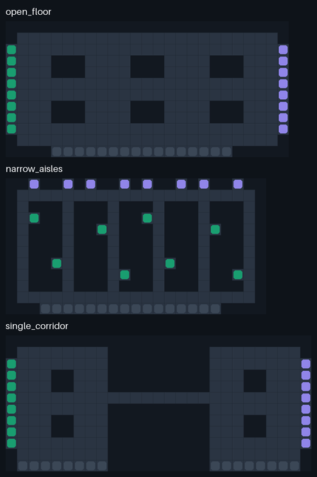
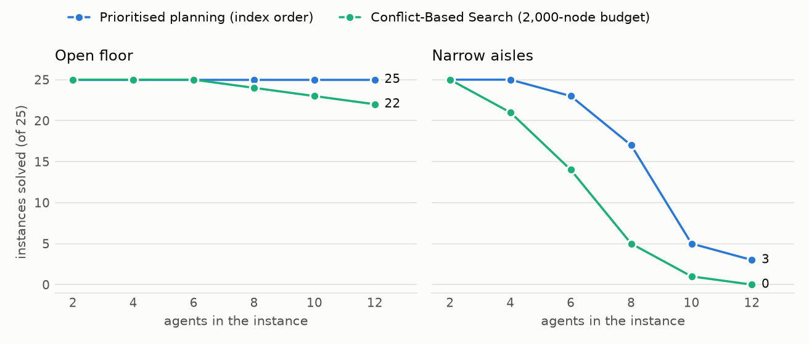

# Design notes

The reasoning behind every choice in this repository, written so that each one
can be defended at a whiteboard. Section numbers match the order in which the
code was built.

## 1. The model

- **Grid and time.** The floor is a 4-connected grid. One cell is 1 m, a robot
  drives at 1 m/s, so one simulation tick is one second and an hour is 3,600
  ticks. In one tick a robot either waits or moves to a neighbouring cell.
- **Cells.** `#` blocked, `.` aisle, `P` pick station, `D` drop station,
  `C` charger. Stations and chargers are *endpoints*: the only cells where a
  robot may rest.
- **Transit rule.** A robot drives on aisle cells and enters an endpoint only
  if it is the goal of its current trip. Bays are never used as shortcuts or
  passing places.
- **Well-formed layout** (Čáp et al. 2015; Ma et al. 2017): the aisle
  cells are connected, every endpoint touches an aisle cell, and there are at
  least as many chargers as robots. Consequence used everywhere below: from
  any endpoint there is a route to any other endpoint that crosses no third
  endpoint, so **a resting robot never blocks a route**.
  `Layout.well_formed_problems` checks it; `FleetSim` refuses a fleet that
  violates it.

All three maps have 8 pick stations (green), 8 drop stations (violet) and
16 chargers (grey). Only the aisles differ: two cells wide everywhere on the
open floor, one cell wide in the narrow aisles, and two halls joined by a
nine-cell single lane in the single corridor.

## 2. Space-time A*

`search.spacetime_astar` plans one robot among moving obstacles.

- **State** $`(v, t)`$: cell $`v`$ at tick $`t`$. **Actions**: wait, or move to a
  neighbour; both take one tick.
- **Constraints**: forbidden pairs $`(v, t)`$, forbidden moves $`(u, v, t)`$
  (leaving $`u`$ at $`t`$ for $`v`$), and parked cells (occupied from some tick on).
- **Cost**, compared lexicographically: (arrival time, effort), where effort
  charges 2 per move, 1 per tick waited on an aisle cell and 0 per tick waited
  on an endpoint.
- **Heuristic**: with $`d(v)`$ the static distance to the goal (one backward
  breadth-first search per goal, cached), $`h(v) = (d(v),\ 2\,d(v))`$.

*Why it is optimal.* One action lowers $`d`$ by at most 1 and costs 1 tick, so
$`h_\text{time}(u) \le 1 + h_\text{time}(v)`$; a move costs effort 2 and lowers
$`2d`$ by at most 2, a wait costs at least 0 and leaves $`d`$ unchanged. Both
components are consistent, lexicographic costs add up like scalars, so A*
closes each state with its optimal cost the first time it pops it.

*Why the effort term exists.* With time as the only cost, "wait three ticks in
the bay" and "drive up and down the aisle for three ticks" are equally good.
The first version of the planner returned the second kind of path: robots
loitered in front of the corridor and got in the way of the trips planned
after them. The effort term picks, among the earliest-arrival paths, one that
waits in its bay. It does not change any arrival time, so the optimality
arguments of CBS are untouched.

*Why it terminates without a horizon.* Let $`t_\text{last}`$ be the latest tick
that appears in a constraint. After it the world is static, so two states
with the same cell and $`t > t_\text{last}`$ are equivalent up to a shift in
time; they share one key. The search space is at most
$`|V| \cdot (t_\text{last} - t_0 + 2)`$ states, and an unreachable goal is
reported as `None` instead of looping.

*Settling.* A trip ends with the robot resting on its goal. The goal test is
therefore "at the goal at a tick $`\ge`$ `settle_from`", where `settle_from` is
one more than the last tick at which the goal cell is reserved or constrained.

Test: 300 random grids with random constraints, compared with a brute-force
dynamic programme over all (cell, tick) pairs on both cost components.

## 3. Reservation table

`reservation.ReservationTable` stores the committed paths of the fleet:

| stored | meaning | conflict it prevents |
|---|---|---|
| `vertex[(v, t)]` | a robot is on $`v`$ at $`t`$ | vertex conflict |
| `moves` contains $`(v, u, t)`$ for each reserved move $`u \to v`$ at $`t`$ | the reverse move | swap conflict |
| `parked[v] = t0` | a robot rests on $`v`$ from $`t_0`$ on | driving into a resting robot |

Following a robot into the cell it leaves is allowed, as in the standard
problem definition (Stern et al. 2019). Writing over an existing reservation
raises `ReservationError`: the table cannot silently hold two robots in a cell.

## 4. The reservation manager

`managers.ReservationManager` is prioritised planning, one trip at a time. It
follows Token Passing (Ma et al. 2017): the table is the token.

**Invariant.** Every robot either rests on an endpoint marked `parked`, or
follows a reserved path that ends on an endpoint where it then parks. A robot
plans only while resting; its path is committed before anyone else plans, and
is then executed exactly.

**Safety** follows by construction: a new path avoids every reserved cell,
every reverse move and every parked cell, and nothing already reserved is
changed. The simulator does not trust this argument and checks every tick.

**A plan always exists.** The planning robot rests on an endpoint nobody else
may enter, so it can wait there. All reserved paths are finite. Once they are
finished every other robot rests on an endpoint, and by well-formedness there
is a route to the goal that avoids all endpoints. "Wait, then take that route"
is a valid plan, so the search cannot fail (the goal itself is free: see the
station locks in section 5).

**Why it cannot gridlock.** Consider, at any tick, the oldest trip still under
way. Every trip planned before it is finished, so every time-stamped
reservation it had to respect now lies in the past. What remains of its path
is an optimal path in a static world, and such a path contains no wait.
Hence *the oldest unfinished trip advances by one cell on every tick*, and a
fleet-wide standstill is impossible. `test_oldest_active_trip_advances_on_every_tick`
checks this lemma directly on all three layouts.

**What it is not.** Prioritised planning is neither optimal nor complete in
general. Here it is complete only thanks to the well-formed layout and the
rule "plan only while resting". Robots are served first come, first served,
so the corridor changes direction more often than a batching policy would.

## 5. Orders and station locks

`sim.FleetSim` owns the task logic, shared by both managers.

- **Demand.** An endless seeded stream of orders, pick and drop stations drawn
  uniformly. The dispatcher sees the 8 oldest open orders. Two managers given
  the same seed see the same order stream.
- **Dispatch.** Oldest order first; it goes to the nearest idle robot (static
  distance to the pick station), provided the pick station is free.
- **Station lock.** A station belongs to one robot from the moment the robot
  is sent to it until the robot has physically left it. A loaded robot leaves
  its pick station only when its drop station is free (longest wait first).
- **Parking.** A robot that finishes on a drop station and gets no order
  drives to the nearest free charger. With at least as many chargers as
  robots one is always free.

No circular wait can appear among the locks: a robot on a drop station always
leaves (new order or free charger), which frees the station that a loaded
robot is waiting for; a pick station is only held by a robot that is coming
or loading. The price is that 8 + 8 stations cap the number of orders in
progress, which is what flattens the throughput curve on the two layouts
where the aisles are not the bottleneck.

**Handling time.** A robot stays docked 2 ticks to load and 2 to unload.

## 6. The naive manager

`managers.NaiveManager` is what a fleet does with no shared plan.

1. Each robot follows its own static A* route.
2. Each tick a robot advances if the cell ahead is empty or is being vacated,
   the move is not a head-on swap, and no robot with a smaller index wants the
   same cell (`_grant_moves`, a fixed-point computation).
3. After 2 to 6 blocked ticks (seeded random back-off, to break symmetry) it
   replans around the robots it sees within 4 cells; if no route exists it
   keeps waiting.

The rule is **safe** (the moves it grants only enter empty or vacated cells)
but **not live**: two robots meeting head-on in a single lane wait for ever.
It is meant as a fair baseline, not a strawman: it has right-of-way,
platooning, back-off and local replanning, and on the open floor it almost
never gridlocks (the counts are in the README table).

**Gridlock.** A run is gridlocked when no robot changes cell for 60
consecutive ticks while at least one robot has a trip. For the naive manager
this state is a fixed point: positions are frozen, so every replanning attempt
sees the same obstacles and fails the same way, and no order can be completed.
The run is cut there and the rest of the hour counts as lost
(`test_a_gridlock_is_a_fixed_point_of_the_simulation` keeps ticking for 300
more ticks and sees nothing move). A *livelock* (robots move but deliver
nothing) is not counted as gridlock; it shows up as low throughput.

## 7. Conflict-Based Search

`cbs.solve_cbs` solves the one-shot problem optimally for the sum of costs
$`\sum_i T_i`$, where $`T_i`$ is the tick after which agent $`i`$ stays on its goal.

- **Low level:** the space-time A* of section 2 for one agent under its own
  constraint set.
- **High level:** best-first search over a binary tree. A node holds one
  constraint set per agent and the resulting paths. If the paths conflict, the
  earliest conflict between agents $`a`$ and $`b`$ produces two children: one
  forbids it to $`a`$, the other to $`b`$.

*Why it is optimal.* (i) Any conflict-free solution that satisfies a node's
constraints satisfies those of at least one child, because the two agents
cannot both use the contested cell or edge at that tick. (ii) A node's cost is
a lower bound on every solution below it, because each path is individually
optimal under fewer constraints. (iii) Nodes are popped by increasing cost.
So the first conflict-free node popped has the lowest cost of all solutions.

*What it cannot do.* It never proves that an instance has no solution, so it
needs a budget (2,000 high-level nodes in the benchmark). Its tree grows
exponentially with the number of conflicts that must be resolved, which is
visible as soon as agents share single-lane aisles.

**Why CBS is not used in the lifelong simulator.** Its guarantees are for a
fixed set of start-goal pairs. Replanning the whole fleet at each new order
would either need a rolling horizon, which gives up optimality, or a runtime
the figure above rules out. The honest use of CBS here is as a reference for
what prioritised planning costs in path length on the instances both solve
(`results/oneshot_summary.csv`, column `prioritised_overhead_pct`).

## 8. The exhaustive oracle

`exhaustive.optimal_sum_of_costs` shares no code with CBS. It runs A* on the
joint state (positions of all agents, set of retired agents). Each tick an
active agent moves or waits (cost 1) or, if it stands on its goal, *retires*
(cost 0, frozen for good). An agent that reaches its goal, leaves to let
another pass and comes back therefore pays for every tick until it finally
stays, which is exactly the sum-of-costs definition. A simpler "pay only when
off the goal" rule would undercount and would make CBS look wrong;
`test_agent_that_leaves_its_goal_pays_until_it_returns` pins the difference.

## 9. Experiment protocol

- **Lifelong.** 3 layouts, 2 managers, fleets of 1, 2, 3, 4, 6, 8, 10, 12, 14
  and 16 robots, seeds 0 to 19, one simulated hour from a cold start (robots
  spread over the chargers). Throughput is the number of orders delivered in
  the hour. Order time runs from assignment to the end of unloading.
- **Saturation fleet.** The smallest fleet whose mean throughput reaches 95 %
  of the best mean over the tested fleets. It is a lower bound when the curve
  still rises at 16 robots, the largest fleet the 16 chargers can park.
- **One-shot.** 25 instances per cell, random distinct starts and distinct
  goals on aisle cells, CBS with a 2,000-node budget against prioritised
  planning in index order. Success is defined by the node budget, not by a
  time limit, so the table is identical on every machine.
- **Wall-clock.** Measured separately, on one core, and stored in
  `results/timings.json` with the name of the processor. It is the only
  result file that changes from one machine to another.
- **Determinism.** No floating point enters the simulation, the only random
  source is `random.Random(seed).randrange`, and heaps are ordered by integer
  tuples. CI reruns a subset on Linux and compares it row by row with the
  tables committed from Windows.

## 10. Questions worth being ready for

- *Deadlock or livelock?* The naive failure in the corridor is a deadlock: a
  cycle of robots each waiting for a cell held by the next. The 60-tick
  standstill rule detects exactly the case where it has swallowed the fleet.
- *Is waiting in the bay realistic?* It is the usual rule of thumb in AGV
  traffic control: do not release a vehicle until its route is clear.
- *What would change on real robots?* Continuous motion and turning times,
  localisation error, delays that break the reserved timing (robust execution
  needs a temporal network or replanning), batteries, and communication.
  None of that is modelled here.
- *Why not one-way aisles?* They are the standard engineering fix and would
  make the naive manager far safer. They are a layout change, not a planner,
  and are left as an obvious follow-up experiment.
